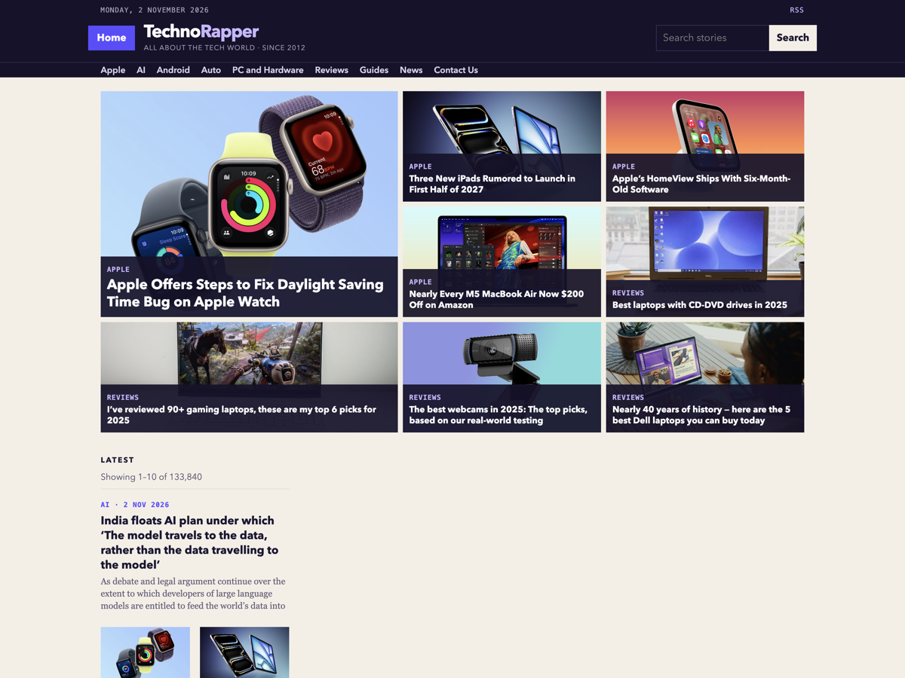

# TechnoRapper

Open-source WordPress magazine theme: a photo board homepage, desk rail, hamburger side menu, paged archives, story pages, and built-in ad slots.



GPL v2 or later. Use it on your own news or review site, fork it, and ship ads from your own account.

## Features

- Photo-board front page with image-led stories
- Desk rail built from your categories
- Hamburger side menu for desks, nested sections, and site pages
- Paged archives, search, and single posts
- RSS at `/feed/` and normal WordPress permalinks
- Ad slots on home, archives, the sidebar, and under posts
- No bundled ad account — each site pastes its own client and slot IDs

## Requirements

- WordPress 6.0+
- PHP 7.4+

## Install

1. Download the repo as a zip, or clone it into `wp-content/themes/technorapper`.
2. In **Appearance → Themes**, activate **TechnoRapper**.
3. **Appearance → Menus**: create a menu and assign it to **Primary**.
4. **Settings → Permalinks → Save** (keep your existing structure).
5. **Appearance → Customize → Ads** to connect units, or leave them empty to show placeholders.

Folder name should stay `technorapper`.

## Ads

The theme reserves these slots:

| Placement | Where | Customizer field |
| --- | --- | --- |
| Banner | Home, under the photo board; also on archives and pages | In-article slot |
| Sidebar | Home rail and story sidebar | Sidebar slot |
| In-article | After the second paragraph and at the end of a post | In-article slot |

1. Open **Appearance → Customize → Ads**.
2. Paste your ad client (`ca-pub-…`) and the two slot IDs from your ad account. If **Google Site Kit** is connected, you can leave the client empty — the theme uses Site Kit’s AdSense client.
3. Publish. Units fill on your live domain (they will not fill on `localhost`).
4. Check **Hide ad placeholders** if you want empty slots hidden until IDs are set. Placeholders are also hidden automatically when Site Kit AdSense is connected, so archives and search do not show the setup boxes.

Google Site Kit can stay active; the theme will not load a second ads script when Site Kit is already printing the AdSense snippet.

Developers can also supply values in a small must-use plugin:

```php
add_filter('technorapper_adsense_client', function () {
    return 'ca-pub-xxxxxxxxxxxxxxxx';
});
add_filter('technorapper_adsense_slot_box', function () {
    return '1234567890';
});
add_filter('technorapper_adsense_slot_article', function () {
    return '1234567890';
});
```

Do not commit real account IDs to a public fork.

## Desks

Desks are category rails (Apple, AI, Android, Reviews, Comics, and so on on technorapper.com). Comics is a supported default desk, placed after Reviews.

**Appearance → Customize → Desks** accepts a comma-separated list of category slugs, in order. For example:

```
apple, ai, android, reviews, comics
```

If you leave that empty, the theme uses the default slugs (including `comics`) when those categories exist, otherwise your eight busiest categories.

The header and drawer use that same list. A desk shows up there as soon as its category exists, including one that has no posts yet. Links already in the Primary menu that are not desks, such as Contact Us and About, stay after the desks.

## Menus and widgets

- **Primary** — top section nav and the side menu (nested items expand with +)
- **Footer** — optional; otherwise the theme prints desks and matching pages
- **Main Sidebar** — extra widgets under the sidebar ad
- **In-story advertisement** — optional widget under a post

## File map

```
header.php / footer.php
assets/js/drawer.js     hamburger side menu
front-page.php          photo board + banner + desks + latest
single.php              story + sidebar ad
archive.php / category.php / search.php
template-parts/         board, rail, feed, card
```

## License

[GPL-2.0-or-later](LICENSE). You may copy, change, and redistribute this theme. Keep the license notice in `style.css`.
